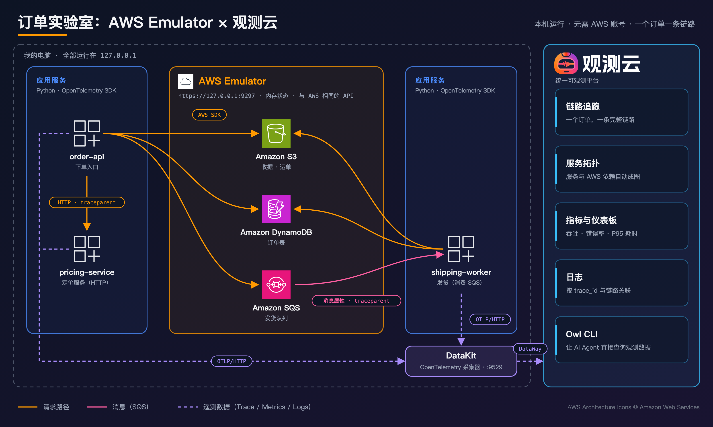
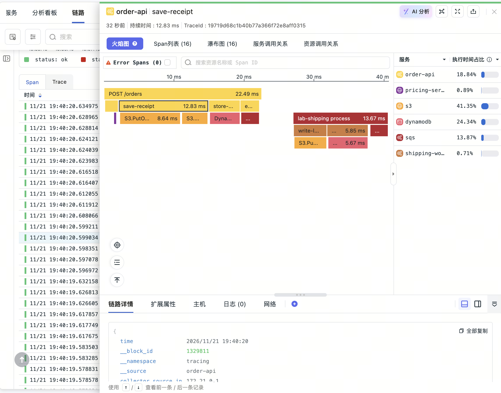
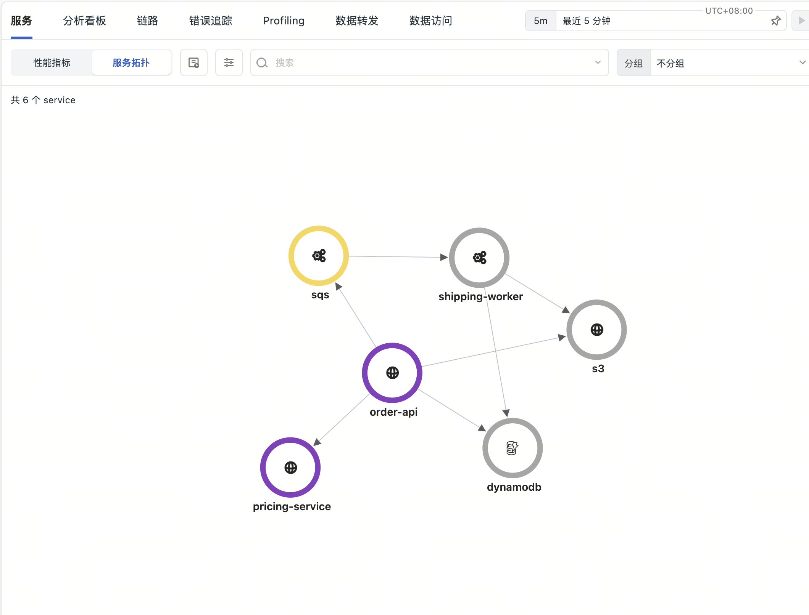
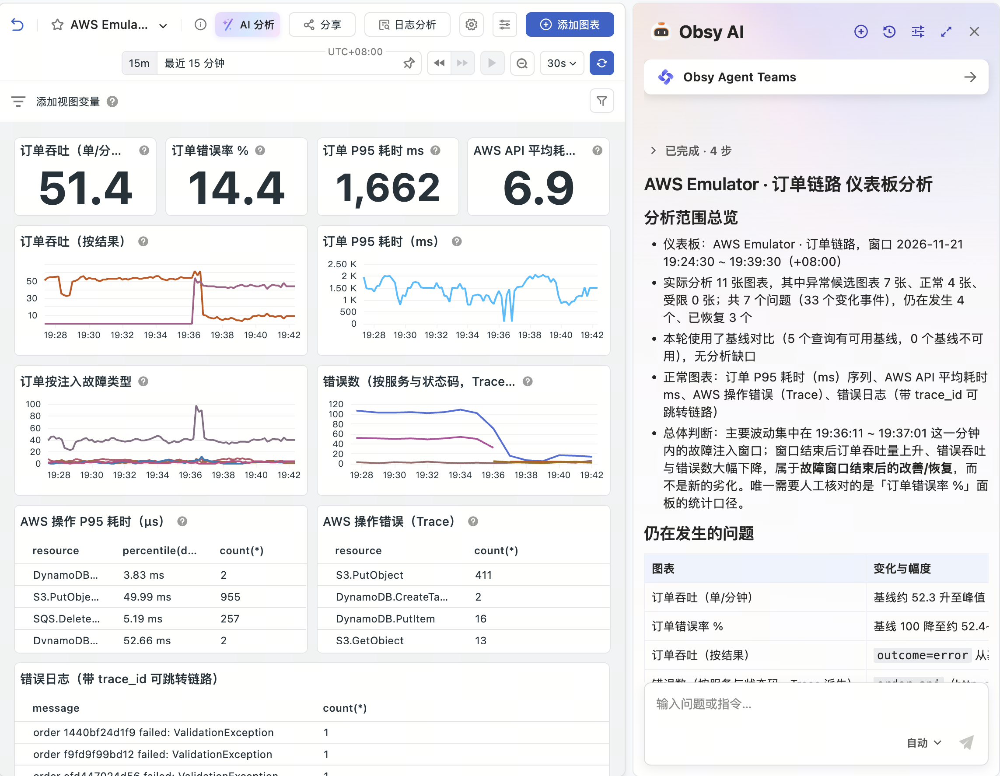
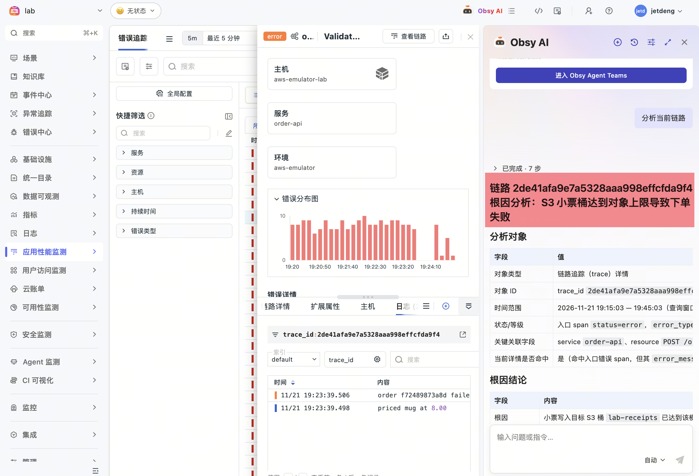

# AWS Emulator → 观测云：本地订单实验室

在一台电脑上跑一个调用 S3、DynamoDB、SQS 的小订单系统。AWS 那一侧由 [AWS Emulator](https://github.com/aws/aws-emulator) 在本机模拟，不需要 AWS 账号；三个服务用 OpenTelemetry 埋点，链路、指标和日志经 DataKit 送进[观测云](https://www.guance.com/)。可以按比例注入故障，在观测云里练习"从异常到根因"。



| 服务 | 作用 |
| --- | --- |
| `order_api.py` | 下单：调用定价服务（HTTP），写 S3 收据、DynamoDB 订单，投递 SQS |
| `pricing_service.py` | 定价 HTTP 服务（`127.0.0.1:8081`），`slow` 故障在这里 |
| `shipping_worker.py` | 消费 SQS，写 S3 运单，把订单标记为 `SHIPPED` |

Trace 上下文通过 HTTP 头（`traceparent`）和 SQS 消息属性跨服务传递，一个订单就是一条完整链路（约 16 个 span，横跨 3 个服务和 S3、DynamoDB、SQS）。

## 准备

- Docker（macOS / Windows 上 AWS Emulator 只能跑在容器里）
- AWS CLI v2、[uv](https://docs.astral.sh/uv/)、Python 3.11+
- 一个观测云工作空间（控制台「集成 → DataKit」里能拿到 DataWay 地址）

## 快速开始

### 1. 启动 AWS Emulator

```bash
docker build -t aws-emulator .          # 从官方 RPM 构建，始终使用最新版
mkdir -p ~/.aws/emulator/9297           # 先建好，否则 Docker 会以 root 身份创建
docker run -d --rm --name aws-emulator \
  --cap-drop ALL --security-opt no-new-privileges --read-only \
  -p 127.0.0.1:9297:9297 \
  -v "$HOME/.aws/emulator/9297:/home/emulator/.aws/emulator/9297" \
  aws-emulator
curl --cacert ~/.aws/emulator/9297/ca.pem https://127.0.0.1:9297/__admin/health   # → ok
```

模拟器每次启动都会在 `~/.aws/emulator/9297/` 写入新的凭证和 CA 证书。把连接变量写进 `~/.aws/emulator/9297.env`：

```bash
cat > ~/.aws/emulator/9297.env <<'EOF'
export AWS_ENDPOINT_URL=https://127.0.0.1:9297
export AWS_SHARED_CREDENTIALS_FILE=$HOME/.aws/emulator/9297/emulator_credentials
export AWS_CONFIG_FILE=$HOME/.aws/emulator/9297/config
export AWS_CA_BUNDLE=$HOME/.aws/emulator/9297/ca.pem
export AWS_EC2_METADATA_DISABLED=true
export AWS_REGION=us-east-1 AWS_DEFAULT_REGION=us-east-1
unset AWS_ACCESS_KEY_ID AWS_SECRET_ACCESS_KEY AWS_SESSION_TOKEN AWS_PROFILE AWS_DEFAULT_PROFILE \
  AWS_WEB_IDENTITY_TOKEN_FILE AWS_ROLE_ARN AWS_ROLE_SESSION_NAME AWS_CONTAINER_CREDENTIALS_RELATIVE_URI \
  AWS_CONTAINER_CREDENTIALS_FULL_URI AWS_CONTAINER_AUTHORIZATION_TOKEN
export AWS_PAGER=""
EOF
( . ~/.aws/emulator/9297.env && aws sts get-caller-identity )   # Account 必须是 000000000000
```

`unset` 那一行很重要：环境变量里的真实凭证优先级高于凭证文件。每个服务启动时也会检查账号，不是 `000000000000` 就直接退出，不会误打到真实 AWS。

模拟器默认开启使用遥测，可以用 `-e EMULATOR_TELEMETRY=off` 关闭。

### 2. 启动 DataKit

```bash
cp .env.example .env.datakit     # 填入 ENV_DATAWAY=https://openway.guance.com?token=tkn_xxx（域名以控制台为准）
docker compose up -d
curl -s http://127.0.0.1:9529/v1/ping
```

只开启了 OpenTelemetry 采集器（`datakit/conf.d/opentelemetry.conf`），端口只绑定本机回环地址，没有 `--privileged`，也不挂载宿主机根目录。`.env.datakit` 含 token，已在 `.gitignore` 里。

### 3. 跑起来

```bash
uv sync
./lab.sh                                    # 每秒一单，15% 报错，10% 变慢；Ctrl-C 全部停止
./lab.sh --loop --interval 0.5 --error-rate 0.3
./run.sh python order_api.py --fault bad-item   # 只下一单，强制某种故障
```

`run.sh` 只在当前进程里加载 `~/.aws/emulator/9297.env`，不会改动你的 shell。

| 故障 | 做了什么 | 现象 |
| --- | --- | --- |
| `missing-object` | 读一张没写过的收据 | S3 404 `NoSuchKey` |
| `bad-param` | 写订单时漏掉主键 | DynamoDB 400 `ValidationException` |
| `bad-item` | 向定价服务查询不存在的商品 | 下游 HTTP 404，错误沿链路传回 order-api |
| `slow` | 定价服务等待约 1 秒 | 只变慢，不报错 |

### 4. 仪表板

`dashboards/order-path.json` 是「AWS Emulator · 订单链路」仪表板，可以用 [Owl CLI](https://static.guance.com/owl/skill.md) 创建：

```bash
python3 -c 'import json; print(json.dumps({"name": "AWS Emulator · 订单链路", "dashboard_json": json.load(open("dashboards/order-path.json"))}, ensure_ascii=False))' \
  | owl exec owl.dashboard.create --stdin
```

指标有三个来源：

| 来源 | 怎么来的 | 适合看什么 |
| --- | --- | --- |
| `otel_service`（应用自定义） | 代码里上报 `orders_total`、`order_duration_ms`，带 `outcome`、`fault` 标签 | 订单成功率、端到端耗时 |
| `tracing_metrics`（DataKit 派生） | `tracing_metric_enable = true`，由链路自动计算 | 各服务请求数、错误数、延迟 |
| 链路统计（DQL `T::`） | 直接查询 span | 单个 AWS API 的 P95 和错误数 |

## 截图

| | |
| --- | --- |
|  |  |
|  |  |

## 踩过的坑

| 现象 | 原因 | 处理 |
| --- | --- | --- |
| 数据发出去了，DataKit 没收到 | DataKit 的 OTLP 路径是 `/otel/v1/*`，不是默认的 `/v1/*` | `otel_setup.py` 里为每种信号单独配置导出地址 |
| pricing-service 的 span 落到了单独的链路里 | `urllib` 把请求头写成 `Traceparent`，按普通 dict 提取上下文时区分大小写 | 提取前把头名统一转成小写 |
| S3、SQS、STS 挤成一个 `aws-api` 节点 | botocore 给所有调用都设置 `rpc.system=aws-api`，DataKit 按它拆分依赖节点 | `request_hook` 改成具体服务名（偏离语义约定，仅用于实验） |
| 拓扑图里有孤立的 `sts` 节点 | 启动时的账号检查不在任何业务 span 里 | `suppress_instrumentation()` 排除 |
| SQS 消费端多出一个 `aws.sqs` 节点 | 消费 span 的 `messaging.system` 和发送端命名不一致 | 两端统一为 `sqs` |
| `tracing_metrics` 用 `rate()` 查不出数据 | 它是按窗口统计的增量，且没有 `resource` 标签 | 用求和；按 API 统计时直接查链路 |
| 跑半小时后错误率涨到 100% | **AWS Emulator 每个 S3 桶最多保存 1000 个对象**，每单写 2 个 | order-api 每 100 单清理一次，只保留最新 500 个 |
| 短命脚本最后一批数据没上报 | 批量导出器来不及发送进程就退出了 | `atexit` 里调用 `shutdown()` |
| DataKit 未启动时日志导出陷入循环 | 导出器的报错日志又被 OTel 日志处理器收集 | SDK 内部日志只打到控制台 |

## 边界

- AWS Emulator 是测试环境：不评估 IAM 权限，状态只在内存里，延迟和容量不代表真实 AWS。本项目里的"慢"都是应用侧注入的。
- 权限、性能和上线前的端到端验证仍然要在真实 AWS 上做。
- 不要把真实凭证或生产数据用在这里。

## 其他

- `tests/test_emulator.py`：对模拟器的基本冒烟测试，`./run.sh pytest`。
- `docs/architecture/make_diagram.py`：重新生成架构图（需要 Google Chrome）。图标来自 AWS Architecture Icons（经 MIT 许可的 `aws-icons` 包），见 `docs/architecture/icons/README.txt`。
